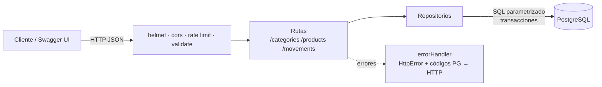
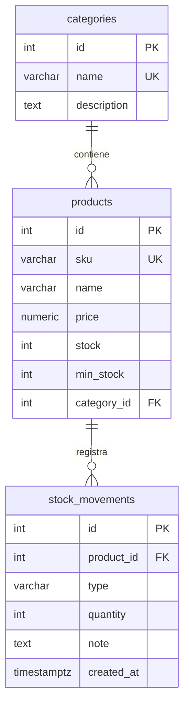

# API REST de Inventario

[](https://github.com/jsonmunoz-dev/api-rest-inventario/actions/workflows/ci.yml)


[](LICENSE)

API REST para gestionar el **inventario** de una tienda: categorías, productos y movimientos de stock.
Está documentada con **OpenAPI 3 / Swagger UI**, se puede levantar con **Docker** y tiene tests unitarios y de integración contra PostgreSQL.

## Puntos destacados

- **Stock consistente**: el stock solo cambia mediante movimientos (`in`/`out`) registrados en una **transacción con `SELECT … FOR UPDATE`**. Así, aunque lleguen salidas simultáneas, el stock nunca queda negativo. Hay un test de integración que lo prueba con 10 salidas en paralelo.
- **Integridad en la base de datos**: `CHECK` (precio y stock no negativos), claves foráneas y `UNIQUE`. Si alguna se viola, la API responde **409** con un mensaje claro.
- **Listados con filtros**: búsqueda por nombre o SKU, categoría, rango de precio, stock bajo, orden y paginación. El `WHERE` se arma con **parámetros posicionales** y el orden con una **lista blanca** de columnas, así que no hay riesgo de inyección SQL.
- **Validación** de body, query y params con **zod**, con errores detallados por campo.
- **Seguridad y operación**: `helmet`, CORS, **rate limiting**, `/health`, Dockerfile **multi-stage** que corre sin usuario root y tiene `HEALTHCHECK`.
- **Documentación verificada**: un test valida el spec OpenAPI y comprueba que estén documentadas todas las rutas.

## Arquitectura





```
src/
├── app.js               # createApp({ repos }): inyección de dependencias
├── server.js            # arranque y apagado ordenado
├── schemas.js           # validaciones zod
├── docs/openapi.yaml    # especificación OpenAPI 3
├── db/                  # pool, migraciones SQL y seed
├── middleware/          # validate, errorHandler
├── repositories/        # SQL (categorías, productos, movimientos)
└── routes/              # endpoints REST
tests/
├── *.test.js            # endpoints con repositorios en memoria
└── integration/         # repositorios contra PostgreSQL real
```

## Cómo ejecutarlo

### Con Docker

```bash
docker compose up --build
```

- Swagger UI: http://localhost:3000/docs
- Spec JSON: http://localhost:3000/docs/openapi.json

### Local

Requisitos: Node.js 20+ y PostgreSQL 14+.

```bash
cp .env.example .env    # ajusta DATABASE_URL
npm install
npm run db:migrate && npm run db:seed
npm run dev
```

## Endpoints (`/api/v1`)

| Método | Ruta                      | Descripción                                         |
| ------ | ------------------------- | --------------------------------------------------- |
| GET    | `/categories`             | Listar categorías (con la cantidad de productos)    |
| POST   | `/categories`             | Crear categoría                                     |
| GET    | `/categories/:id`         | Obtener categoría                                   |
| PUT    | `/categories/:id`         | Reemplazar categoría                                |
| DELETE | `/categories/:id`         | Eliminar (409 si tiene productos)                   |
| GET    | `/products`               | Listar con filtros, orden y paginación              |
| POST   | `/products`               | Crear producto (con `initialStock` opcional)        |
| GET    | `/products/:id`           | Obtener producto                                    |
| PATCH  | `/products/:id`           | Actualizar parcialmente (el stock no se edita aquí) |
| DELETE | `/products/:id`           | Eliminar producto                                   |
| GET    | `/products/:id/movements` | Historial de movimientos                            |
| POST   | `/products/:id/movements` | Registrar entrada o salida de stock                 |

### Ejemplos

```bash
# Productos con stock bajo, ordenados por precio descendente
curl "http://localhost:3000/api/v1/products?lowStock=true&sort=price&order=desc"

# Registrar una venta (salida de stock)
curl -X POST http://localhost:3000/api/v1/products/1/movements \
  -H "Content-Type: application/json" \
  -d '{"type":"out","quantity":2,"note":"Venta boleta 1234"}'
```

Respuesta si no alcanza el stock:

```json
{ "error": "Stock insuficiente: disponible 1, solicitado 2" }
```

## Tests

```bash
npm test                 # unitarios y de endpoints (sin base de datos)
npm run test:coverage    # con reporte de cobertura
npm run test:integration # requiere DATABASE_URL apuntando a PostgreSQL
```

En **GitHub Actions** el pipeline corre lint, los tests con cobertura y la integración contra PostgreSQL 16. Además levanta el stack con `docker compose` y hace un **smoke test** con `curl`.

## Próximos pasos

- Autenticación con API keys o JWT para las operaciones de escritura.
- Reportes de valorización del inventario.
- Exportación a CSV.
- Despliegue en Render o Railway con una base de datos gestionada.

## Autor

**Jheyson Muñoz**: estudiante de Analista Programador en INACAP Valparaíso.
[GitHub](https://github.com/jsonmunoz-dev)

## Licencia

[MIT](LICENSE)
